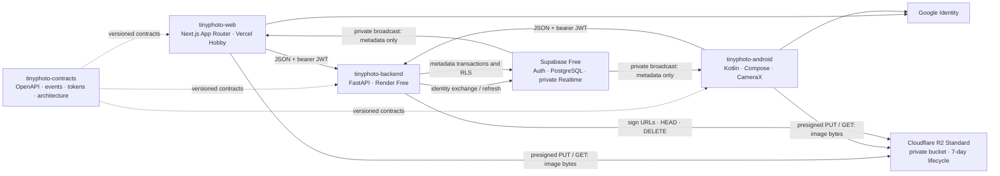

# tinyphoto — Master plan

Contract version: 1.0.0. Decision date: 2026-10-30. This repository is the normative specification; the three application repositories implement it independently. This is a design baseline, not a claim that deployments or billing safeguards already exist.

## 1. Product and scope

Authenticated users shoot an individual stamp or join a collaborative photo booth using a six-digit code. A room supports 2–4 members, one host, one active round and four shots per round. Every member captures their own camera at each shared shutter deadline. This is synchronized still photography; it does not stream live video between participants. A group composition is a grid of participating members, with four successive grids arranged vertically into a strip. Individual shooting uses the same media pipeline without a room. Stamp decoration is composed before upload. Memories contain committed final compositions, not pending uploads.

MVP includes Google login, permission handling, camera preview, mirrored preview with unmirrored output, countdown, four-shot rounds, RAM composition, direct upload, expiring memories, explicit user-initiated export of finished photos to device gallery (`Pictures/tinyphoto`), room recovery, and accessible error states. Excluded: video calls, face recognition, background processing on devices, persistent drafts, offline gallery, purchase flows, and implicit/background disk caches or temporary capture files. Leaving the app can lose unsent frames; explain this before camera access.

## 2. Deployment and repository ownership



Use Render as the baseline Python host. It supports conventional FastAPI/Uvicorn and avoids depending on Workers runtime package compatibility. Cloudflare Python Workers support FastAPI/ASGI and are an alternative only after HTTP database adapter, signing, JWT and runtime tests pass; do not deploy a second public API or keep two authorities. Workers Free is not required in the baseline. No API image proxy, multipart endpoint, Vercel image optimizer or backend compositor is permitted. Render cold start is handled before a round; a sleeping process never owns a countdown timer.

The contracts repo owns protocol versions and JSON token values; backend owns migrations and RLS; web and Android own camera/composition adapters. Pin a contracts release tag plus checksum in each consumer. Independent Git histories, CI and deployment credentials are required. The present workspace directories are working locations; creation of remote repositories is outside this step.

## 3. Persistence and authorization

PostgreSQL stores metadata only: profiles(id = auth user UUID, display_name); rooms(id, code, host_id, state, version, expires_at); room_members(room_id, user_id, joined_at, active); rounds(id, room_id, state, version, participant_ids, shutter_times, upload_deadline, composition_deadline); uploads(id, owner_id, room_id nullable, round_id nullable, shot_index nullable, purpose, object_key, expected_size, content_type, status, expires_at, purge_after); memories(id, owner_id, media_id, created_at, expires_at); event_outbox(event_id, room_id, room_version, payload, published_at); idempotency_records(actor_id, route, key, request_hash, response, expires_at); quota_reservations(upload_id, bytes, state, expires_at). No base64, thumbnails, image bytea, public object URLs or presigned URLs in database rows.

Use UUID identifiers, timestamptz UTC, uniqueness on active room code, (round_id, owner_id, shot_index) for slot uploads, and (owner_id, media_id) for memories. Generate codes uniformly with a cryptographic RNG, preserve leading zeros, retry collisions inside a transaction. A code locates a room; it is not authorization. Rooms expire 60 minutes after creation, codes are not reused for 24 hours, and clients retain room UUIDs after joining.

All application table writes go through backend commands and atomic database functions. Row locks serialize room mutations, member capacity, code reservation, upload reservations and quota counters. Direct client SQL writes are denied. Read RLS allows users their profile, own memories and membership-scoped room metadata. Clients receive no service-role key. Backend verifies Supabase JWT signature using cached JWKS, issuer, audience, subject and expiry; unknown key refreshes JWKS once. Administrative adapters still explicitly enforce actor ownership and membership before every command. Security-definer functions use a fixed search_path and narrowly granted execution rights.

Private topic: `room:<room_id>:v<channel_epoch>`. Snapshot returns the exact topic. Disable public Realtime access. SELECT authorization on realtime.messages checks active membership and current channel epoch; authenticated clients have no INSERT broadcast policy. Only committed backend transitions produce authoritative events. On membership removal/leave, rotate epoch in the same transaction, publish MEMBER_LEFT on the old topic, and let remaining members fetch the new snapshot and rejoin. Existing subscriptions can retain cached authorization; therefore the old topic must receive no subsequent round data. Events contain identifiers only, never image bytes or media URLs. Short JWT expiry and reauthentication supplement topic rotation.

Room states: LOBBY → ACTIVE → LOBBY; any state → CLOSED; expiry is terminal. Starting a round freezes participants, requires all active members ready, 2–4 active members and no current round. Host cannot leave ACTIVE; members cannot leave ACTIVE until completion, cancellation or deadline. Host leaving LOBBY closes the room. Room close cancels an active round. Presence and disconnects do not mutate membership or transfer host. A disconnected participant stays reserved; host can cancel, or deadlines resolve the round.

Round states: COUNTDOWN → COLLECTING → COMPOSING → COMPLETE; nonterminal → CANCELLED or EXPIRED. Four shutter timestamps are 4 seconds apart, first 5 seconds after command commit. Upload deadline is 90 seconds after last shutter; composition deadline is 120 seconds after upload deadline. Server never accepts a slot before its shot timestamp or after its upload deadline. Once all participant × 4 slots commit, state becomes COMPOSING. Only host can upload the group composition; it must reference all committed slots in the frozen set. Its completion creates an independent memory record for each participant, all referencing the same media. A participant can delete their own memory reference; physical shared deletion occurs only when all references are gone and the issued PUT can no longer be used. Other participants cannot upload a replacement final. No partial group memory on timeout; clients release RAM and may start a new round.

Retain successful final compositions for at most 7 days from reservation; use that exact expires_at for all memory references. Slot objects are unreadable after final completion and queued for deletion after outstanding PUTs expire. Room-source ACL never extends object expiry. Pending objects and failed rounds have purge_after at most 15 minutes after reservation. Logical expiry applies immediately, even if provider lifecycle deletion is delayed. R2 lifecycle expires all objects after 7 days as a backstop; opportunistic authenticated requests plus scheduled metadata cleanup remove abandoned rows and objects. A cleanup scheduler is not needed for shutter timing. Keep quota reservations until deletion is confirmed; suspended cleanup must stop new reservations safely.

## 4. Google authentication

```mermaid
sequenceDiagram
  participant C as Web / Android (RAM)
  participant G as Google Identity
  participant B as FastAPI
  participant S as Supabase Auth
  C->>C: Generate random raw nonce in RAM
  C->>G: GIS popup / Credential Manager (SHA-256 nonce)
  G-->>C: Google ID token
  C->>B: POST /auth/google {id_token, nonce}
  B->>S: signInWithIdToken(provider=google, token, raw nonce)
  S->>S: Verify Google issuer, audience, expiry, nonce
  S-->>B: Supabase session + user
  B-->>C: access + refresh tokens; Cache-Control: no-store
  C->>B: GET /auth/me (Supabase bearer token)
  B-->>C: User identity
  C->>S: Authenticate private Realtime with access token
```

Configure web and Android Google client IDs in the Supabase allowed audience list. Use the token flow supported by each platform, with the raw nonce given to Supabase and its SHA-256 hexadecimal representation given to Google. An at_hash-bearing Google token additionally requires the matching provider access token. Do not log identity tokens, passwords, or nonce values. Raw nonces, passwords, and E2EE chat private keys live only in memory. Authentication session tokens (`access_token`, `refresh_token`, `expires_at`, and non-sensitive cached `user` metadata) may persist on the client solely through the sanctioned platform auth-storage adapters (`token-storage.ts` using `localStorage` on web with cross-tab refresh locks and `storage` sync; `EncryptedSessionStorage.kt` using Android Keystore AES-256-GCM + `MODE_PRIVATE` `SharedPreferences` on Android with backup disabled). Disable Supabase SDK session persistence (`persistSession: false`) and serialize refresh requests. Refresh 60 seconds before expiry, preserve stored sessions on transient `503`/network failures, and clear stored sessions on explicit logout or `401 UNAUTHENTICATED`. Unauthenticated `POST /api/v1/auth/register` must reject any already-registered email (including Google-only accounts) with `409 CONFLICT` to prevent account takeover. Logout revokes the refresh session, clears RAM and persisted auth tokens, and closes channels; already-issued bearer URLs and JWTs remain usable until expiry. CSP, exact API CORS origins, rate limiting, and HTTPS are required.

## 5. RAM capture and upload

```mermaid
sequenceDiagram
  participant C as Camera / Canvas RAM
  participant B as FastAPI
  participant D as PostgreSQL
  participant R as Private R2
  C->>C: Capture → resize → stamp → encode Blob/ByteArray
  C->>B: POST /media/presigned-upload (metadata + idempotency key)
  B->>D: Authorize + atomically reserve bytes and operations
  B-->>C: media_id, PUT URL, exact headers, expiry
  C->>R: PUT bytes directly, signed Content-Type and Content-Length
  R-->>C: 200
  C->>B: POST /media/{media_id}/complete
  B->>R: HEAD server-assigned immutable key
  R-->>B: Size + content type + ETag
  B->>D: Commit slot / final memory + event outbox atomically
  B-->>C: Media receipt
  C->>C: Release Blob, revoke object URL, close bitmap
  C->>B: POST /media/{media_id}/presigned-download
  B-->>C: GET URL valid 60 seconds
  C->>R: Fetch no-store directly into RAM
  R-->>C: Image bytes; Cache-Control: no-store
```

Only image/avif, image/jpeg and image/png (contract 1.1.0); 2,000,000 bytes per slot/individual, 4,000,000 per group composition. Client target is ≤1 MB per object. Output limits: max 1500px per single photo unit (single stamp 1095×1500; 1×3 photobooth 1500×3285; 2×3 photobooth 3000×3285; 2×2 grid 3000×3000; 1×4 strip 1500×4380; group tile 1500×1125; composite product upper bound 6000×6000 and ≤24M pixels). Prefer AVIF (8-bit, sRGB) encoded in client RAM: start around quality 0.60 and lower in steps (downscaling proportionally if still over byte cap). A perforated stamp must keep its alpha channel, so it is AVIF with alpha or PNG, never JPEG. Opaque slots, strips and grids fall back to JPEG quality 0.85, lowering if required. Verify the encoded Blob/ByteArray really is image/avif (browsers may silently fall back to PNG) and declare the actual type and exact byte length in the reservation. AVIF reservations stay behind a backend operator gate (`AVIF_UPLOADS_ENABLED`) until every reader decodes AVIF and real R2 browser/Android conformance passes; a 422 means re-encode in RAM with the fallback type. Strip EXIF/location, never upscale a tiny sensor unnecessarily. The backend never encodes, converts or perforates images. Decode sequentially; four 1500×1125 RGBA frames occupy 27.0 MB and a 1500×4380 canvas another 26.28 MB before GPU/camera overhead. Group host downloads/composes one source at a time into a bounded output canvas. Abort on memory pressure; do not spill to disk.

PUT expiry 120 seconds, GET expiry 60 seconds. Backend chooses a random, unguessable key; never accepts object keys from clients. The R2 signing adapter must include Content-Type, Content-Length and Cache-Control in signed headers, with exact expected length and `no-store, max-age=0`. Browser sets Content-Length from the Blob automatically; it must not try to set that forbidden request header manually. Return it separately as required_content_length. Verify real browser and Android interoperability against R2 before shipping; deny issuance if the signing adapter cannot enforce exact length. A presigned PUT is reusable until expiry, not single-use. Prevent post-commit substitution by signing `If-None-Match: *` and requiring an R2 conformance test showing a second PUT gets 412; do not claim immutable completion until this test passes. Deny upload issuance if conditional create is unsupported in the deployed R2 API. HEAD verifies actual size/type, but does not prove the image's pixel content or dimensions. Keep all objects private, decode with bounded memory, and treat image decoder failures as untrusted-content errors. Client-provided dimension metadata is informational, never a security boundary.

R2 CORS allows only web production and explicit development origins, PUT/GET/HEAD, Content-Type, Cache-Control and If-None-Match; expose ETag. Android does not rely on CORS. API returns no-store on every response, Referrer-Policy: no-referrer, and excludes authorization, query strings and response bodies from telemetry. R2 URLs bypass Next Image, Coil disk cache and service workers. Web uses fetch(cache='no-store') → Blob → temporary object URL; Android uses an in-memory HTTP/image pipeline with HTTP and decoder disk caches disabled. CameraX uses ImageAnalysis/ImageProxy or in-memory capture callbacks, not OutputFileOptions. No unauthorized MediaStore, temporary files, saved photo state, filesystem upload buffering, server request-body image logging, sessionStorage, IndexedDB, Cache API, or media in localStorage. Disable Android backup and sensitive-screen recents snapshots where supported. Stop camera tracks and close channels on exit.

The application makes no image writes to local persistent storage. An absolute guarantee about OS swap, GPU drivers, crash dumps, screenshots, browser internals or third-party capture is not technically enforceable by an ordinary web/Android app. This limitation must be disclosed in privacy documentation; do not advertise forensic zero-residue storage. Synthetic contract fixtures contain no user photography.

## 6. Realtime countdown and recovery

```mermaid
sequenceDiagram
  participant H as Host
  participant B as FastAPI
  participant D as PostgreSQL + outbox
  participant S as Supabase private Broadcast
  participant M as Members
  H->>B: POST /rooms/{id}/rounds (expected_version)
  B->>D: Lock room; freeze participants; persist four deadlines
  D-->>B: Snapshot + HOST_START_COUNTDOWN event
  B-->>H: Round + server_time
  B->>S: Publish committed outbox event
  S-->>M: HOST_START_COUNTDOWN (absolute shutter times)
  par Camera on each device
    H->>H: Monotonic local timer captures at scheduled deadlines
    M->>M: Monotonic local timer captures at scheduled deadlines
  end
  M->>B: POST /rounds/{round_id}/shutters/{shot_index}
  B->>D: Idempotent materialize due shutter, no early trigger
  B->>S: SHUTTER_TRIGGERED (scheduled + committed timestamp)
  Note over H,M: Confirmation event never causes a second capture
  M->>B: Complete uploaded slot
  B->>D: Commit slot + SLOT_UPLOADED
  B->>S: Publish SLOT_UPLOADED
  M->>B: GET room snapshot after gap / reconnect
  B-->>M: Current round, slots, epoch, room version, server_time
```

Measure clock offset using three GET /time requests; midpoint offset = server_time − (send_wall + receive_wall)/2. Choose the lowest RTT sample and anchor estimated server time to performance.now / elapsedRealtime. Re-sync before each round and after resume. Display an approximate-sync indicator if RTT >250 ms or uncertainty >125 ms; require explicit ready again after resume. Network timestamps do not guarantee simultaneous hardware exposure. Target foreground capture skew ≤250 ms in controlled-device acceptance tests, record capture timestamps, report measured results. No per-second network ticks. Camera must already be streaming and permission granted before ready.

Every room mutation increments one monotonically increasing room_version and produces exactly one logical event; no-ops produce neither. COUNTDOWN can become COLLECTING during first due shutter materialization. A slot completion may create COMPOSING; its SLOT_UPLOADED payload carries round_state. Final completion creates COMPLETE with ROUND_COMPLETED. Expiry is materialized by the next command/snapshot or cleanup. Store outbox entries transactionally with metadata; dispatch after commit and retry on future API requests/cleanup. Delivery can duplicate, reorder or disappear: this is not exactly-once transport. Client deduplicates event_id, ignores older versions, fetches snapshot on any gap, then resumes at snapshot version. Snapshot and its version are transactionally consistent. Subscribe and buffer first, fetch snapshot second, discard buffered versions ≤snapshot, then apply contiguous events. Poll at most every 15 seconds only while an active room's channel is unavailable; stop on close/expiry. A shutter confirmation can be materialized late by any frozen participant; its scheduled_at stays unchanged. A resumed client never recreates missed shots; timeout or cancel resolves missing slots.

Use Idempotency-Key UUID for mutating POST commands except authentication; read-only download grants also omit it. Scope to actor + route, retain for 24 hours, reject reused keys with changed bodies. Store result metadata only; reconstruct upload grants from their original signing timestamp and expiry, never persist tokens or signed URLs in idempotency records. Replays return the original logical result, including original URL expiry; after expiry issue a new reservation only after the previous one is terminal. Complete and shutter commands also have intrinsic media/shot uniqueness. Expected room version is required for host commands; conflicts return 409 with fresh snapshot obtained separately. Retry 429/503 using Retry-After and jitter; never retry indefinitely. Database unavailability returns 503 before issuing URLs.

Starting a round requires at least 300 seconds remaining before room expiry. Before reserving a slot, its owner materializes the due shutter through the shutter endpoint; otherwise return 409 SHUTTER_NOT_DUE. This keeps shutter and slot events as separate ordered transitions. PUT grant expiry is capped by the relevant upload/composition deadline. Creation emits MEMBER_JOINED for the host; ready no-ops do not emit. Room expiry/close emits one enclosing event that also identifies any affected round, without a second round event at the same room_version.

## 7. $0 capacity model and enforcement

Sizing scenario, decimal units: 100 rooms/day × 4 people × 4 slots = 1,600 slots/day; 100 group finals + 200 individual finals = 1,900 objects/day. At 1 MB average and seven-day retention, steady live storage is 13.3 GB: this exceeds the R2 free allocation. Therefore this attractive growth target is rejected.

Admitted MVP scenario: 20 rooms/day × (16 slots + 1 group final) + 60 individual finals/day = 400 objects/day; 12,000/month. At 1 MB average, seven-day storage ≤2.8 GB before cleanup delays. Worst case at permitted sizes: 20×(16×2+4)+60×2 = 840 MB/day; seven days = 5.88 GB. Daily global admitted bytes ≤840,000,000; global reserved+live bytes ≤7,000,000,000. Pending upload reservations count immediately. At most 400 new reservations/day and 12,000 per rolling 30 days; retries of the same reserved key are capped at 2 by client policy, while URL abuse remains a residual risk. Read URL issuance ≤100,000/month, room snapshots ≤300,000/month, users ≤1,000 MAU. Per user: 30 reservations/day, 200 MB retained, 5 create/join attempts/minute; per IP: 20 join attempts/minute; room code failure returns generic 404. Limit 20 simultaneous rooms, 80 normal participants and 120 realtime connections including reconnect overlap. Each account has at most one active room membership.

| Service | Verified free allowance / caveat | MVP estimate / enforced budget |
| --- | --- | --- |
| R2 Standard | 10 GB-month; 1M Class A; 10M Class B; direct egress free | ≤7 GB live including reservations; ~12k PUTs, cleanup/list overhead budget 50k A; 100k GET grants + 24k HEADs, budget 500k B |
| Supabase database | 500 MB/project | Metadata target <100 MB; stop room creation at 350 MB; event/idempotency retention 24h; provider realtime tables also consume space |
| Supabase Realtime | 2M messages/month; 200 peak connections; 100 messages/s | 600 rooms/month × 32 events × (1+4 deliveries) = 96k messages before churn; reserve 500k total, operational ceiling 1.5M; 120 connections; dispatch ≤10 events/s globally |
| Supabase Auth / egress | 50k MAU; 5 GB egress | ≤1k MAU; metadata and JWT traffic target <1 GB; no photos routed through Supabase |
| Render Free | 750 instance-hours/workspace/month; sleeps after 15 min idle; bandwidth/build quotas account-specific | One service ≤744 hours in a 31-day month; no artificial keepalive; check dashboard before launch; target backend outbound <1 GB |
| Vercel Hobby | Personal noncommercial use; up to 1M edge requests listed in plan | Static assets aggressively cached, authenticated metadata no-store; target ≤300k requests/month; no media proxy or optimizer |

Prices/allowances checked 2026-10-30; provider terms may change. Free tier is an allowance, not infinite capacity or an automatic $0 cap. Before public launch, verify account-wide usage, billing behavior, payment requirements and budget settings. Do not enable paid upgrades, paid compute, paid Workers or paid image transforms. App counters reserve against global bytes, operations and daily admissions transactionally; if unavailable or exceeded, return 429 QUOTA_EXCEEDED. Operational alerts at 50/70/85% precede a manual issuance shutdown at 85% of any provider quota. A budget alert alone does not block charges. Signed URLs can be reused outside app counters and hostile clients can bypass client retry policy; direct bearer URLs prevent a mathematical guarantee of zero bill under arbitrary abuse. Keep URLs short, conditional writes, account-level controls where available and the deployment small/private until residual risk is accepted. If strict no-overage is mandatory and the provider offers no hard spend limit, public R2 direct upload is blocked; do not falsely promise absolute $0.

Broadcast message count includes fanout; channel churn/presence can add messages. Disable high-frequency Presence, do not publish thumbnails or timer ticks. Use an outbox dispatcher token bucket to absorb round bursts; delayed broadcast does not move persisted shutter times. R2 lifecycle is asynchronous; reservations are not released on logical expiry alone. Delete a pending object only after its PUT expires to prevent orphan recreation. R2 monthly storage is averaged daily peak usage, so live caps leave margin, but account-wide unrelated buckets also count.

## 8. Milestones and release gates

1. Contracts: validate OpenAPI 3.1, JSON Schema 2020-12, reference resolution, event/API parity, version compatibility, and shared tokens. Consumer agents read this repo before modifying protocol; no private copies silently diverge.
2. Backend: migrations/RLS, Google session exchange, locked room transitions, idempotency, quota reservations, R2 signing and completion, outbox recovery, cleanup. Test two simultaneous joins/starts, replayed completes, unauthorized downloads, old-topic membership removal and expired media.
3. Web: camera permission states, RAM-only single shooting, stamp and strip composition, no-store direct R2 pipeline, then room synchronization and reconnect. Test browser storage/network inspection and memory cleanup.
4. Android: same use cases with CameraX, bounded ByteArrays/Bitmaps, lifecycle cancellation and disabled image disk caches. Inspect app files/cache/MediaStore and backups during instrumented capture; process death loses only unsent work.
5. Cross-platform: one web + one Android + two mixed members complete four shots; verify ordering, drift measurement, host cancel, duplicate event, late foreground, 503 and quota rejection. Test real R2 signed size/conditional headers before enabling uploads. Validate final compositions and storage absence on supported target devices. No production readiness claim until these gates pass.

## 9. Primary sources

- [R2 pricing](https://developers.cloudflare.com/r2/pricing/) — free Standard allowances and GB-month accounting.
- [R2 presigned URLs](https://developers.cloudflare.com/r2/api/s3/presigned-urls/) — S3 endpoint, signed content type and CORS.
- [R2 S3 compatibility](https://developers.cloudflare.com/r2/api/s3/api/) — atomic conditional PUT; real-client signing remains a release test.
- [Supabase billing](https://supabase.com/docs/guides/platform/billing-on-supabase) — database, auth, egress and connections.
- [Realtime usage accounting](https://supabase.com/docs/guides/platform/manage-your-usage/realtime-messages) and [limits](https://supabase.com/docs/guides/realtime/limits) — fanout and throughput.
- [Realtime authorization](https://supabase.com/docs/guides/realtime/authorization) — private channel RLS and cached access policy implications.
- [Database broadcast](https://supabase.com/docs/guides/realtime/broadcast) — transport and provider retention behavior.
- [Google Auth](https://supabase.com/docs/guides/auth/social-login/auth-google) — ID tokens and nonce convention.
- [Render Free](https://render.com/docs/free) — cold starts, shared hours and bandwidth caveats.
- [Vercel Hobby](https://vercel.com/docs/plans/hobby) — noncommercial eligibility and quotas.
- [Cloudflare Python FastAPI](https://developers.cloudflare.com/workers/languages/python/packages/fastapi/) — alternative ASGI runtime.
